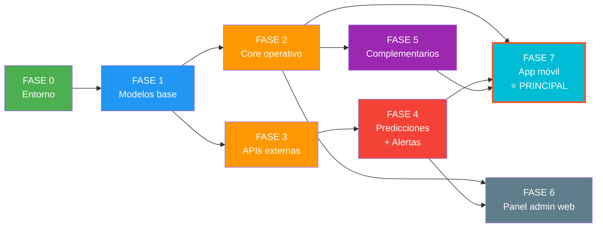

# 🔥 WillAI — Plan Maestro del Proyecto
## Sistema de Alerta Temprana de Incendios Forestales — Coracora, Parinacochas, Ayacucho

> **Documento vivo** — Actualizar conforme avancemos. Leer al inicio de cada sesión para recuperar contexto.

---

## 📌 Decisiones de arquitectura (acordadas en esta sesión)

| Decisión | Elección | Razón |
|---|---|---|
| **Backend** | Django 5.x (Python) | Evitar microservicios: GeoDjango nativo, ML directo, un solo lenguaje |
| **API** | Django REST Framework | Estándar maduro para APIs REST |
| **App móvil** | React Native (Expo) | Una codebase para iOS + Android |
| **Frontend web** | React (SPA) o Django Templates + HTMX | Por definir en fase 4 |
| **Base de datos** | PostgreSQL 16 + PostGIS 3.4 | Superior a MySQL para geoespacial |
| **Tareas async** | Celery + Redis | Importación FIRMS, alertas, FWI |
| **WebSockets** | Django Channels | Mapa en tiempo real |
| **ML/Predicciones** | scikit-learn + cffdrs (local) | Sin microservicio Python separado |
| **Admin panel** | Django Admin | Gratis, incluido |
| **Archivos** | S3 / MinIO | Evidencias fotográficas/video |

### APIs externas a consumir

| API | Propósito | Key | Frecuencia |
|---|---|---|---|
| NASA FIRMS | Focos de calor satelitales | MAP_KEY (gratis) | Cada 3h |
| SERFOR | Focos + alertas Perú | No necesita | Cada 30min |
| Open-Meteo | Meteorología (temp, humedad, viento, precip) | No necesita | Cada 1h |
| cffdrs (local) | Cálculo FWI | N/A (librería) | Cada 6h |

### Esquema SQL de referencia
- Archivo: [alerta_incendios_coracora.sql](file:///c:/Users/MARX/Desktop/Nueva%20carpeta/WillAi/alerta_incendios_coracora.sql)
- 30 tablas, 12 módulos
- Diseñado para MySQL → se migra a PostgreSQL vía modelos Django
- Revisado y aprobado (sin errores bloqueantes)

---

## 🏗️ Plan de ejecución por fases

---

### FASE 0 — Entorno de desarrollo ✅ (COMPLETADO)
**Objetivo:** Tener el proyecto Django corriendo con PostgreSQL + PostGIS

**Tareas:**
- [x] Instalar Python 3.12+ (Python 3.13.7 disponible en `.venv`)
- [x] Instalar PostgreSQL 16+ (PostgreSQL 18.1 local detectado y conectado)
- [x] Crear base de datos `alerta_incendios_coracora` en PostgreSQL
- [x] Crear proyecto Django con estructura de carpetas definida (`backend/`)
- [x] Configurar `settings/base.py`, `development.py`, `production.py`
- [x] Configurar conexión a PostgreSQL en settings con `psycopg 3`
- [x] Instalar dependencias base: `djangorestframework`, `django-cors-headers`, `psycopg-binary`, `celery`, `redis`, `django-environ`, `drf-spectacular`
- [x] Crear `requirements.txt` y `docker-compose.yml`
- [x] Verificar que `python manage.py runserver` funcione (verificado en puerto 8000)
- [x] Verificar que Django Admin y Swagger carguen (`/admin/` y `/api/docs/` HTTP 200)
- [x] Crear superusuario inicial de desarrollo (gestionado de forma segura vía variables de entorno)

**Criterio de completitud:** `manage.py runserver` corre sin errores y Django Admin es accesible. ✅ CUMPLIDO.

---

### FASE 1 — Modelos base (geografía + usuarios) ✅ (COMPLETADO)
**Objetivo:** Las tablas fundamentales que todo lo demás referencia

**Apps Django creadas:**
- [x] `apps/geografia/` → `Distrito`, `Comunidad`
- [x] `apps/usuarios/` → `Usuario` (custom extendiendo `AbstractUser`), `Rol`, `Permiso`, `UsuarioRol`, `RolPermiso`

**Tareas completadas:**
- [x] Crear modelo `Usuario` extendiendo `AbstractUser` de Django (UUID, estado, teléfono, roles N:M)
- [x] Crear modelos geográficos (`Distrito`, `Comunidad`) con centroides, tipos y soporte GeoJSON
- [x] Registrar modelos en Django Admin con inlines, filtros y búsqueda avanzada
- [x] Crear serializers y ViewSets con DRF (distritos, comunidades, roles, permisos y registro de ciudadanos)
- [x] Ejecutar `makemigrations` + `migrate` en PostgreSQL
- [x] Cargar datos semilla vía comando `python manage.py seed_base` (5 roles, 13 permisos, Coracora + 5 comunidades)
- [x] Crear superusuario de prueba (`admin` / `admin12345`)
- [x] Suite de pruebas unitarias implementada y pasando (6/6 tests OK)

**Criterio de completitud:** Modelos migrados, admin funcional, datos semilla cargados, endpoints API verificados. ✅ CUMPLIDO.

**Dependencias:** Fase 0

---

### FASE 2 — Módulos operativos core ✅ (COMPLETADO)
**Objetivo:** Reportes, incidentes, brigadas — el flujo principal del sistema

**Apps Django creadas:**
- [x] `apps/respuesta/` → `Entidad`, `Brigada`, `Brigadista`, `RecursoEmergencia`
- [x] `apps/reportes/` → `Reporte`, `Evidencia`, `Sincronizacion`, `ValidacionReporte`
- [x] `apps/incidentes/` → `Incidente`, `ReporteIncidente`, `HistorialIncidente`, `AccionAtencion`, `AsignacionBrigada`, `CierreIncidente`

**Tareas completadas:**
- [x] Crear todos los modelos mapeando el esquema SQL completo (14 tablas operativas)
- [x] Historial automático de estados de incidentes con usuario responsable y nota
- [x] Serializers con DRF para creación, listado, detalle, evidencias e incidencias
- [x] ViewSets con filtros, búsqueda y permisos por rol
- [x] Registrar en Django Admin con inlines jerárquicos (evidencias en reportes, asignaciones y acciones en incidentes)
- [x] Crear endpoints API especializados:
  - `POST /api/v1/reportes/reportes/` — creación de reporte ciudadano con coordenadas, dirección del viento y foto
  - `POST /api/v1/reportes/reportes/{id}/validar/` — validación por verificador
  - `POST /api/v1/reportes/reportes/sync_offline/` — sincronización en lote para app móvil sin conexión
  - `GET /api/v1/incidentes/incidentes/` — listar incidentes activos y prioritarios
  - `POST /api/v1/incidentes/incidentes/{id}/asignar_brigada/` — asignar brigada con instrucciones
  - `PATCH /api/v1/incidentes/incidentes/{id}/estado/` — transiciones de estado
  - `POST /api/v1/incidentes/incidentes/{id}/cerrar/` — cierre y liquidación del incidente
- [x] Tests unitarios para modelos, acciones y vistas (13/13 tests OK)

**Criterio de completitud:** Se puede crear un reporte, validarlo, crear un incidente, asignar una brigada, registrar acciones y cerrar incidentes vía API y Admin. ✅ CUMPLIDO.

**Dependencias:** Fase 1

---

### FASE 3 — Integración de APIs externas ✅ (COMPLETADO)
**Objetivo:** Importar datos de NASA FIRMS, SERFOR y Open-Meteo automáticamente

**Apps Django creadas:**
- [x] `apps/firms/` → `FuenteSatelital`, `LoteImportacionFirms`, `DeteccionSatelital`, `LoteDeteccionesFirms`, `DeteccionIncidente`
- [x] `apps/meteorologia/` → `ObservacionMeteorologica`, `ZonaRiesgo`, `Vivienda`, `ResidenteVivienda`, `EvaluacionExposicion`

**Tareas completadas:**
- [x] Celery Beat configurado con schedule automatizado:
  - FIRMS: cada 3h (`importar_firms_task`)
  - SERFOR focos: cada 30min (`importar_serfor_task`)
  - Open-Meteo: cada 1h (`importar_openmeteo_task`)
- [x] Ingesta de NASA FIRMS implementada con soporte de BBox para Coracora/Parinacochas e idempotencia SHA-256
- [x] Ingesta de SERFOR implementada para ArcGIS REST MapServer de focos de calor
- [x] Ingesta de Open-Meteo probada en tiempo real (temperatura, humedad, viento, precipitación)
- [x] Comandos de ejecución manual creados:
  - `python manage.py importar_firms --sensor VIIRS_NOAA20_NRT --days 1 --serfor`
  - `python manage.py importar_meteo --lat -15.0189 --lon -73.7806`
- [x] Endpoints API listos:
  - `GET /api/v1/firms/detecciones/`
  - `GET /api/v1/firms/fuentes/`
  - `GET /api/v1/meteorologia/observaciones/`
  - `GET /api/v1/meteorologia/observaciones/actual/`
  - `POST /api/v1/meteorologia/viviendas/`
- [x] Django Admin para lotes, focos de calor y observaciones meteorológicas
- [x] Tests unitarios con datos reales y mock pasando (16/16 tests OK)

**Criterio de completitud:** Las tareas de ingesta satelital y meteorológica funcionan de forma automática y manual, almacenando focos y clima en PostgreSQL. ✅ CUMPLIDO.

**Dependencias:** Fase 1 (modelos base), Redis instalado

---

### FASE 4 — Predicciones + Alertas ✅ (COMPLETADO)
**Objetivo:** Calcular riesgo FWI, evaluar viviendas expuestas, enviar alertas

**Apps Django creadas:**
- [x] `apps/predicciones/` → `ModeloPredictivo`, `EjecucionModelo`, `Prediccion`
- [x] `apps/alertas/` → `AlertaEmergencia`, `PreferenciaNotificacion`, `DestinatarioAlerta`

**Tareas completadas:**
- [x] Implementación matemática en Python puro del Sistema Canadiense FWI (`fwi.py`): FFMC, DMC, DC, ISI, BUI y FWI calibrado para hemisferio sur (Perú)
- [x] Task `calcular_riesgo_fwi_task()` programada en Celery para ejecutarse automáticamente
- [x] Evaluador de exposición de viviendas con fórmula geodésica de Haversine (`evaluar_exposicion_y_alertar_task`)
- [x] Generación automatizada de alertas de emergencia cuando se detecta peligro alto o crítico a menos de 5 km de viviendas rurales
- [x] Encolado y entrega de notificaciones a residentes con registro de lectura confirmada
- [x] Comando manual: `python manage.py calcular_fwi --lat -15.0189 --lon -73.7806`
- [x] Endpoints API listos:
  - `GET /api/v1/predicciones/predicciones/` — listado de predicciones
  - `GET /api/v1/predicciones/predicciones/actual/` — índice FWI y nivel de peligro actual
  - `GET /api/v1/alertas/alertas/` — catálogo de alertas públicas
  - `GET /api/v1/alertas/alertas/mis_alertas/` — buzón personal del usuario autenticado
  - `POST /api/v1/alertas/alertas/{id}/confirmar/` — confirmación de lectura de alerta
- [x] Django Admin para modelos predictivos, ejecuciones, predicciones y alertas
- [x] Pruebas unitarias completas pasando (19/19 tests OK)

**Criterio de completitud:** El sistema detecta automáticamente riesgo FWI alto → identifica viviendas rurales expuestas → genera la alerta de emergencia → despacha a los residentes y registra la confirmación de lectura. ✅ CUMPLIDO.

**Dependencias:** Fase 3 (datos meteorológicos disponibles)

---

### FASE 5 — Módulos complementarios ✅
**Objetivo:** Gamificación, donaciones, auditoría

**Apps Django creadas:**
- [x] `apps/gamificacion/` → `Insignia`, `ActividadUsuario`, `UsuarioInsignia`
- [x] `apps/donaciones/` → `Donante`, `OfertaDonacion`, `ItemOfertaDonacion`, `AsignacionDonacion`, `HistorialOfertaDonacion`
- [x] `apps/auditoria/` → `Auditoria` + middleware

**Tareas completadas:**
- [x] Implementar motor de evaluación de insignias (signals automáticas al validar reportes y comando `seed_insignias`)
- [x] Implementar flujo de donaciones con moderación (aprobación/rechazo con historial y asignación a brigadas/incidentes con control de stock)
- [x] Implementar middleware de auditoría automática (`AuditLoggingMiddleware` con hash SHA-256 anónimo de IPs)
- [x] Endpoints API documentados en Swagger para cada módulo
- [x] Cargar datos semilla de las 4 insignias base (`primer_aviso`, `guardian_bosque`, `vigilante_comunal`, `comunidad_preparada`)
- [x] Tests unitarios pasando al 100% (23/23 tests OK)

**Criterio de completitud:** Insignias se otorgan automáticamente al validar reportes. Donaciones pueden ser publicadas, moderadas y asignadas. Auditoría registra trazabilidad forense. ✅ CUMPLIDO.

**Dependencias:** Fase 2 (reportes e incidentes)

---

### FASE 6 — Centro de Mando Táctico Web (Admin & Operaciones) ✅ (COMPLETADO)
**Objetivo:** Panel de operaciones web **solo para administradores y operadores de emergencia** (COEP/COEL/OGRD) conectado 100% a APIs oficiales reales sin datos sintéticos ni mock.

> ⚠️ **El web NO es para usuarios finales.** Ciudadanos y brigadistas usarán la app móvil React Native.

**Tecnología:** Django Admin extendido + Django Templates + **Frontend SPA React + Vite + TypeScript (`frontend/`)** con Leaflet.js y Lucide Icons.

**Tareas completadas:**
- [x] Extender Django Admin con vistas personalizadas y acceso directo al Centro de Mando Táctico
- [x] Dashboard administrativo táctico (`/panel/`) y Frontend SPA interactivo (`http://localhost:5173/`):
  - Mapa de operaciones táctico con imágenes satelitales ESRI en vivo de Coracora
  - Capas satelitales NASA FIRMS independientes: **MODIS [1km]** con huella circular y **VIIRS [375m]** con pulso de precisión
  - Capa de **SERFOR Perú** conectada directamente al MapServer oficial
  - **Barra de tiempo histórica de NASA FIRMS**: filtros rápidos `TODAY`, `24HRS`, `7D`, `30D`, `3M`, `6M` y modal de rango de fechas personalizado
  - **Descarga histórica oficial de 180 días**: comando `importar_firms_historico --dias 180 --paso 5` con 252 detecciones satelitales reales almacenadas en PostgreSQL
  - **Motor de Machine Learning de Viento (12 horas)**: modelo Random Forest Multi-Output (`WindProphet ML`) entrenado sobre series reales de Open-Meteo proyectando vector direccional, rumbo de propagación $(\theta + 180)^\circ$ y conos GeoJSON de dispersión
  - Botón de re-entrenamiento en tiempo real del modelo ML con Open-Meteo
  - Widget meteorológico en vivo con temperatura, humedad, ráfagas y cálculo Canadiense FWI
- [x] Paginación satelital cartográfica (`DeteccionPagination`) permitiendo consultar hasta 3000-5000 puntos en mapa sin truncamiento
- [x] Gestión de reportes, despacho de brigadas, cierre formal con acta de liquidación
- [x] Eliminación completa de datos simulados y fallbacks mock en todo el frontend y backend
- [x] 32 pruebas unitarias completas pasando al 100% (`Ran 32 tests in 64.325s OK`)

**Criterio de completitud:** Un operador visualiza detecciones satelitales reales de NASA FIRMS (MODIS + VIIRS hasta 6 meses), el cono de dispersión ML de viento a 12 horas, meteorología en vivo de Open-Meteo y gestiona incidentes y brigadas desde el Centro de Mando. ✅ CUMPLIDO.

**Dependencias:** Fases 2-5 (API completa)

---

### FASE 7 — App móvil React Native (INTERFAZ PRINCIPAL) ✏️
**Objetivo:** App para **TODOS los usuarios** — ciudadanos, brigadistas, verificadores y operadores

> ⚠️ **Esta es la interfaz principal del sistema.** La mayoría de usuarios solo interactúa por aquí.

**Roles y funcionalidades por rol:**

#### 🏠 Poblador (ciudadano)
- [ ] Registro / login
- [ ] Mapa de riesgo en tiempo real (detecciones, incidentes, zonas FWI)
- [ ] Reportar incendio (formulario + cámara + GPS + offline)
- [ ] Ver estado de sus reportes
- [ ] Recibir alertas push de emergencia
- [ ] Ver alertas recibidas e instrucciones
- [ ] Registrar su vivienda (ubicación + preferencias de alerta)
- [ ] Ver y recibir insignias
- [ ] Ofrecer donaciones (víveres, herramientas, transporte)

#### 🚒 Brigadista
- [ ] Todo lo del poblador +
- [ ] Ver asignaciones de brigada activas
- [ ] Aceptar/rechazar asignaciones
- [ ] Reportar acciones de atención (con foto y ubicación)
- [ ] Ver recursos de emergencia disponibles
- [ ] Recibir instrucciones de operador

#### ✅ Verificador
- [ ] Todo lo del poblador +
- [ ] Listar reportes pendientes de validación
- [ ] Validar/observar/rechazar reportes con comentario
- [ ] Validar actividades para insignias

#### 📋 Operador de emergencia (vista móvil limitada)
- [ ] Mapa operativo con todas las capas
- [ ] Cambiar estado de incidentes
- [ ] Aprobar alertas urgentes desde el móvil
- [ ] Ver estadísticas rápidas

#### 🔧 Funcionalidades transversales
- [ ] Autenticación con tokens (DRF TokenAuth o SimpleJWT)
- [ ] Push notifications (expo-notifications + FCM)
- [ ] Sincronización offline (SQLite local + cola de sync)
- [ ] Navegación por tabs según rol del usuario
- [ ] Perfil personal + configuración de notificaciones
- [ ] Modo offline: reportar sin conexión, sincronizar al reconectar
- [ ] Testing en dispositivos reales Android + iOS

**Criterio de completitud:** Cada rol puede realizar todas sus funciones desde la app. Un ciudadano puede reportar con foto+GPS, un brigadista acepta asignaciones, un verificador valida reportes — todo sin necesitar el web.

**Dependencias:** Fases 2-5 (API completa + alertas + gamificación + donaciones)

---

## 📂 Estructura de archivos del proyecto

```
c:\Users\MARX\Desktop\Nueva carpeta\WillAi\
├── alerta_incendios_coracora.sql     # Esquema SQL de referencia (NO se ejecuta)
├── LogoWillai.jpeg                   # Logo del proyecto
├── backend/                          # ← Proyecto Django (FASE 0)
│   ├── manage.py
│   ├── requirements.txt
│   ├── .env                          # Variables de entorno (no commitear)
│   ├── config/
│   │   ├── settings/
│   │   │   ├── base.py
│   │   │   ├── development.py
│   │   │   └── production.py
│   │   ├── urls.py
│   │   ├── celery.py
│   │   ├── asgi.py
│   │   └── wsgi.py
│   ├── apps/
│   │   ├── geografia/
│   │   ├── usuarios/
│   │   ├── respuesta/
│   │   ├── reportes/
│   │   ├── incidentes/
│   │   ├── firms/
│   │   ├── meteorologia/
│   │   ├── predicciones/
│   │   ├── alertas/
│   │   ├── gamificacion/
│   │   ├── donaciones/
│   │   └── auditoria/
│   ├── core/                         # Utilidades compartidas
│   └── templates/
│
└── mobile/                           # ← Proyecto React Native (FASE 7)
    ├── App.js
    ├── package.json
    └── src/
```

---

## 🚀 Orden de ejecución



**Empezamos por: FASE 0 → Configurar el entorno de desarrollo y crear el proyecto Django.**

---

## 📚 Documentos de referencia (esta sesión)

| Documento | Contenido |
|---|---|
| [analisis_sql.md](file:///C:/Users/MARX/.gemini/antigravity-ide/brain/2cd7e4ef-bf6e-4ad4-acef-3aa2edcb7570/analisis_sql.md) | Revisión del esquema SQL (30 tablas, 12 módulos) |
| [factibilidad_laravel_rn.md](file:///C:/Users/MARX/.gemini/antigravity-ide/brain/2cd7e4ef-bf6e-4ad4-acef-3aa2edcb7570/factibilidad_laravel_rn.md) | Análisis Laravel vs Django (descartado Laravel) |
| [arquitectura_django_rn.md](file:///C:/Users/MARX/.gemini/antigravity-ide/brain/2cd7e4ef-bf6e-4ad4-acef-3aa2edcb7570/arquitectura_django_rn.md) | Arquitectura Django + React Native elegida |
| [integracion_apis.md](file:///C:/Users/MARX/.gemini/antigravity-ide/brain/2cd7e4ef-bf6e-4ad4-acef-3aa2edcb7570/integracion_apis.md) | Integración NASA FIRMS + SERFOR (endpoints, código) |
| [datos_meteorologicos.md](file:///C:/Users/MARX/.gemini/antigravity-ide/brain/2cd7e4ef-bf6e-4ad4-acef-3aa2edcb7570/datos_meteorologicos.md) | Open-Meteo + FWI para predicciones (endpoints, código) |
| **Este documento** | Plan maestro con las 8 fases de ejecución |
