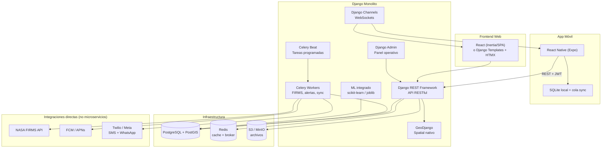

# Arquitectura Unificada: Django + React Native

## ¿Por qué Django elimina los microservicios?

> [!IMPORTANT]
> Con Django todo corre en **un solo backend en Python**. No necesitas un microservicio separado para ML, ni paquetes externos para geoespacial, ni servicios adicionales para tareas asíncronas.

### Comparación directa: qué cambia vs Laravel

| Necesidad | Con Laravel | Con Django |
|---|---|---|
| **Geoespacial** | ⚠️ Paquete externo `grimzy/laravel-mysql-spatial` + SQL raw | ✅ **GeoDjango** — módulo oficial, ORM nativo con `ST_Contains`, `ST_Distance`, etc. |
| **Modelos predictivos** | ❌ Microservicio Python (FastAPI) obligatorio | ✅ `scikit-learn`, `TensorFlow`, `XGBoost` directo en el mismo proyecto |
| **NASA FIRMS** | ✅ HTTP Client + Jobs | ✅ `requests` + Celery tasks — mismo resultado |
| **API REST** | ✅ Laravel API Resources | ✅ **Django REST Framework (DRF)** — igual de maduro |
| **Auth + permisos** | ✅ Sanctum + Spatie | ✅ `django.contrib.auth` + `django-guardian` (permisos por objeto) |
| **Tareas async** | ✅ Laravel Queue (Redis) | ✅ **Celery** + Redis — estándar de la industria |
| **Notificaciones push** | ✅ Laravel Notifications | ✅ `django-push-notifications` + FCM |
| **Admin panel** | ⚠️ Construir o usar Nova ($) | ✅ **Django Admin** — gratis, poderoso, ya integrado |
| **WebSockets** | ✅ Laravel Reverb | ✅ Django Channels |
| **Base de datos** | MySQL | **PostgreSQL + PostGIS** (superior para geoespacial) |

> [!NOTE]
> **Cambio de BD recomendado:** Tu esquema MySQL se migra a PostgreSQL sin problemas. PostGIS es el estándar de la industria geoespacial y GeoDjango lo aprovecha al máximo. Los `SPATIAL INDEX`, `SRID 4326`, `POINT`, `GEOMETRY` que ya tienes funcionan igual o mejor en PostGIS.

---

## 🏗️ Arquitectura — Todo en un solo backend



> [!TIP]
> Las únicas "APIs externas" que quedan son **integraciones de datos** (NASA FIRMS para obtener detecciones) y **proveedores de envío** (FCM para push, Twilio para SMS). Estas no son microservicios tuyos — son servicios externos que cualquier stack necesita consumir.

---

## 📁 Estructura del proyecto Django

```
alerta_incendios_coracora/
├── manage.py
├── requirements.txt
├── config/                          # Configuración del proyecto
│   ├── settings/
│   │   ├── base.py                  # Settings comunes
│   │   ├── development.py
│   │   └── production.py
│   ├── urls.py                      # URL root
│   ├── celery.py                    # Configuración Celery
│   ├── asgi.py                      # Para Channels (WebSockets)
│   └── wsgi.py
│
├── apps/
│   ├── geografia/                   # Módulo 1: distritos, comunidades
│   │   ├── models.py
│   │   ├── serializers.py
│   │   ├── views.py
│   │   ├── admin.py
│   │   └── tests/
│   │
│   ├── usuarios/                    # Módulo 2: auth, roles, permisos
│   │   ├── models.py                # Usuario custom + roles
│   │   ├── serializers.py
│   │   ├── views.py
│   │   ├── permissions.py           # Permisos DRF custom
│   │   └── admin.py
│   │
│   ├── respuesta/                   # Módulo 3: entidades, brigadas, recursos
│   │   ├── models.py
│   │   ├── serializers.py
│   │   ├── views.py
│   │   └── admin.py
│   │
│   ├── reportes/                    # Módulo 4: reportes, evidencias, sync, validación
│   │   ├── models.py
│   │   ├── serializers.py
│   │   ├── views.py
│   │   ├── tasks.py                 # Celery: procesar evidencias, sync
│   │   └── admin.py
│   │
│   ├── incidentes/                  # Módulo 5: incidentes, historial, acciones, cierres
│   │   ├── models.py
│   │   ├── serializers.py
│   │   ├── views.py
│   │   ├── signals.py               # Disparar historial automático
│   │   └── admin.py
│   │
│   ├── firms/                       # Módulo 6: NASA FIRMS, detecciones satelitales
│   │   ├── models.py
│   │   ├── serializers.py
│   │   ├── views.py
│   │   ├── tasks.py                 # Celery: polling FIRMS, importación por lotes
│   │   ├── importers.py             # Lógica de deduplicación (clave_deteccion)
│   │   └── admin.py
│   │
│   ├── meteorologia/                # Módulo 7: meteo, zonas riesgo, viviendas, exposición
│   │   ├── models.py
│   │   ├── serializers.py
│   │   ├── views.py
│   │   ├── evaluador.py             # Lógica espacial: ST_Contains, ST_Distance
│   │   └── admin.py
│   │
│   ├── alertas/                     # Módulo 8: alertas, preferencias, destinatarios
│   │   ├── models.py
│   │   ├── serializers.py
│   │   ├── views.py
│   │   ├── tasks.py                 # Celery: envío masivo, reintentos
│   │   ├── channels.py              # Canales: push, SMS, correo, WhatsApp
│   │   └── admin.py
│   │
│   ├── gamificacion/                # Módulo 9: insignias, actividades
│   │   ├── models.py
│   │   ├── serializers.py
│   │   ├── views.py
│   │   ├── engine.py                # Motor de evaluación de criterios
│   │   └── admin.py
│   │
│   ├── predicciones/                # Módulo 10: modelos ML — SIN microservicio
│   │   ├── models.py                # modelos_predictivos, ejecuciones, predicciones
│   │   ├── serializers.py
│   │   ├── views.py
│   │   ├── tasks.py                 # Celery: ejecutar modelo en background
│   │   ├── ml/
│   │   │   ├── entrenar.py          # Scripts de entrenamiento
│   │   │   ├── predecir.py          # Inferencia con joblib/pickle
│   │   │   └── modelos/             # Artefactos .joblib guardados
│   │   └── admin.py
│   │
│   ├── auditoria/                   # Módulo 11: log de auditoría
│   │   ├── models.py
│   │   ├── middleware.py            # Captura automática de acciones
│   │   └── admin.py
│   │
│   └── donaciones/                  # Módulo 12: donantes, ofertas, asignaciones
│       ├── models.py
│       ├── serializers.py
│       ├── views.py
│       ├── signals.py               # Actualizar cantidad_disponible automáticamente
│       └── admin.py
│
├── core/                            # Utilidades compartidas
│   ├── mixins.py                    # Mixins de timestamp, UUID, etc.
│   ├── pagination.py
│   ├── exceptions.py
│   └── geo_utils.py                 # Helpers geoespaciales reutilizables
│
└── templates/                       # Si usas Django Templates para web
    └── ...
```

---

## 🔑 Ejemplo: lo que antes era microservicio, ahora es directo

### ML Predictivo — sin microservicio

```python
# apps/predicciones/tasks.py
from celery import shared_task
import joblib
from django.contrib.gis.geos import GEOSGeometry
from .models import EjecucionModelo, Prediccion, ModeloPredictivo

@shared_task
def ejecutar_prediccion(id_ejecucion):
    """Corre el modelo ML directamente en Celery — mismo proceso Python."""
    ejecucion = EjecucionModelo.objects.select_related('modelo').get(pk=id_ejecucion)
    
    # Cargar modelo entrenado (scikit-learn, XGBoost, etc.)
    modelo_ml = joblib.load(ejecucion.modelo.artefacto_uri)
    
    # Preparar features (datos FIRMS + meteo + topografía)
    features = preparar_features(ejecucion)
    
    # Inferencia directa — sin HTTP, sin API, sin microservicio
    resultados = modelo_ml.predict_proba(features)
    
    # Guardar predicciones con geometría
    for r in resultados:
        Prediccion.objects.create(
            ejecucion=ejecucion,
            geometria=GEOSGeometry(r['wkt'], srid=4326),
            horizonte_desde=r['desde'],
            horizonte_hasta=r['hasta'],
            probabilidad=r['probabilidad'],
            nivel=clasificar_nivel(r['probabilidad']),
        )
    
    ejecucion.estado = 'completado'
    ejecucion.save()
```

### Geoespacial — sin paquetes externos

```python
# apps/meteorologia/evaluador.py
from django.contrib.gis.db.models.functions import Distance
from django.contrib.gis.geos import Point
from django.contrib.gis.measure import D
from apps.meteorologia.models import Vivienda, ZonaRiesgo

def evaluar_viviendas_en_riesgo(zona_riesgo):
    """Encuentra viviendas dentro de una zona de riesgo.
    GeoDjango traduce esto a PostGIS: ST_Contains, ST_DWithin, etc.
    Sin SQL raw, sin paquetes externos."""
    
    return Vivienda.objects.filter(
        ubicacion__within=zona_riesgo.geometria,  # ST_Contains nativo
        activa=True
    ).annotate(
        distancia=Distance('ubicacion', zona_riesgo.geometria)  # ST_Distance
    ).order_by('distancia')


def viviendas_cercanas_a_deteccion(lat, lon, radio_km=5):
    """Viviendas en un radio de X km de una detección FIRMS."""
    punto = Point(lon, lat, srid=4326)
    
    return Vivienda.objects.filter(
        ubicacion__distance_lte=(punto, D(km=radio_km)),
        activa=True
    ).annotate(
        distancia=Distance('ubicacion', punto)
    ).order_by('distancia')
```

---

## 📌 Stack definitivo

| Capa | Tecnología |
|---|---|
| **Backend** | Django 5.x + Django REST Framework |
| **Base de datos** | PostgreSQL 16 + PostGIS 3.4 |
| **Geoespacial** | GeoDjango (incluido en Django) |
| **ML / Predicciones** | scikit-learn + joblib (mismo proceso Python) |
| **Tareas async** | Celery + Redis |
| **WebSockets** | Django Channels |
| **Frontend web** | React (SPA) ó Django Templates + HTMX |
| **App móvil** | React Native (Expo) |
| **Cache** | Redis |
| **Archivos** | S3 / MinIO |
| **Push** | Firebase Cloud Messaging |
| **SMS/WhatsApp** | Twilio (integración directa) |
| **Admin/Operaciones** | Django Admin (gratis, ya incluido) |
| **Servidor** | Gunicorn + Nginx |

---

## ⚠️ Única consideración: migrar el esquema de MySQL a PostgreSQL

Tu esquema SQL actual está escrito para MySQL. Los cambios principales serían:

| MySQL | PostgreSQL |
|---|---|
| `BIGINT UNSIGNED AUTO_INCREMENT` | `BIGSERIAL` o `BigAutoField` (Django lo maneja) |
| `ENUM(...)` | Django usa `CharField(choices=...)` internamente |
| `GEOMETRY NOT NULL SRID 4326` | Mismo concepto, PostGIS lo maneja igual |
| `JSON` | `JSONB` (más eficiente, indexable) |
| `utf8mb4` | UTF-8 es nativo en PostgreSQL |
| `ENGINE=InnoDB` | No aplica (PostgreSQL no tiene motores) |
| `SPATIAL INDEX` | `CREATE INDEX ... USING GIST(...)` (Django lo crea automático) |

> [!TIP]
> **No necesitas migrar el SQL manualmente.** Django genera las migraciones automáticamente a partir de los modelos Python. Tu archivo SQL sirve como referencia de diseño, y Django crea las tablas con `python manage.py migrate`.

---

## ✅ Resumen: qué ganas con este cambio

| Antes (Laravel + microservicios) | Ahora (Django monolito) |
|---|---|
| 2 lenguajes backend (PHP + Python) | **1 solo lenguaje (Python)** |
| Microservicio FastAPI para ML | **ML integrado en el mismo proyecto** |
| Paquete externo para spatial | **GeoDjango oficial, nativo** |
| Laravel Nova ($199/sitio) para admin | **Django Admin gratis** |
| 2+ servicios que desplegar | **1 solo servicio + workers Celery** |
| Coordinar comunicación inter-servicios | **Import directo entre módulos** |
