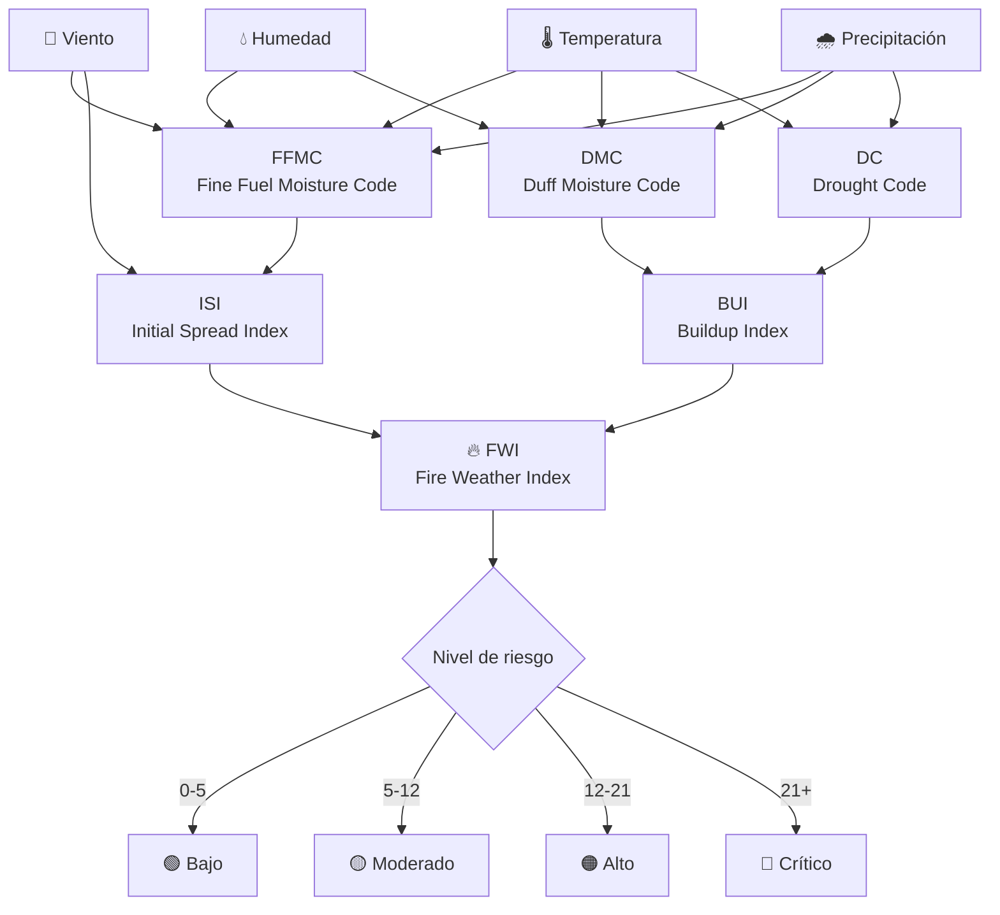
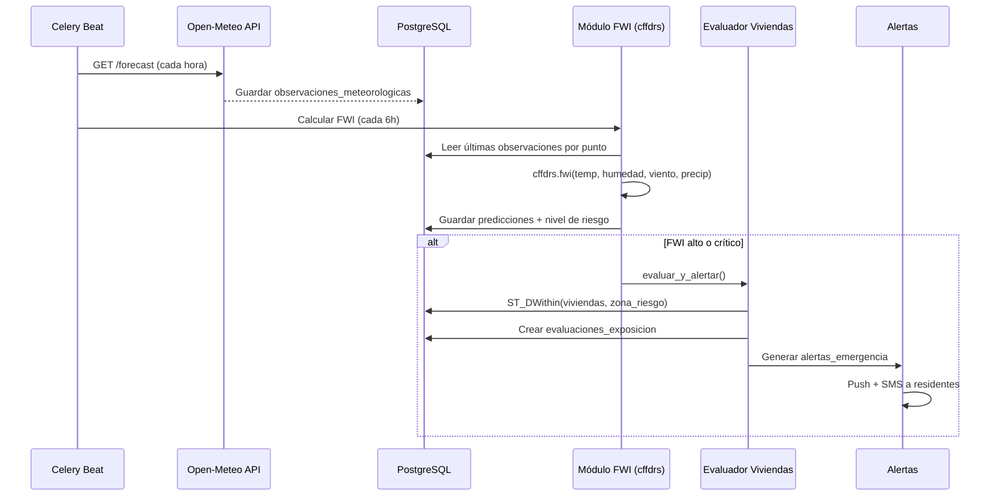

# Datos Meteorológicos para Predicción de Incendios

## El problema con SENAMHI

> [!WARNING]
> **SENAMHI no tiene una API REST pública** documentada para consumir datos meteorológicos en tiempo real (temperatura, humedad, viento, precipitación). Sus opciones son:
> - Descarga manual de CSV/TXT desde su portal
> - Web scraping (frágil, no confiable para producción)
> - Datasets periódicos en datos abiertos (no tiempo real)
> 
> **No es viable como fuente principal automatizada.**

---

## ✅ La solución: Estrategia multi-fuente

| Fuente | Qué aporta | API Key | Costo | Confiabilidad |
|---|---|---|---|---|
| **Open-Meteo** | Temperatura, humedad, viento, precipitación, radiación solar (actual + pronóstico + histórico) | ❌ No necesita | Gratis (no comercial) | ⭐⭐⭐⭐⭐ |
| **SENAMHI** (web scraping) | Datos oficiales peruanos, estaciones locales en Ayacucho | ❌ No tiene | Gratis | ⭐⭐ (frágil) |
| **NASA POWER** | Radiación solar, temperatura, humedad — datos satelitales globales | ❌ No necesita | Gratis | ⭐⭐⭐⭐ |
| **Copernicus CDS** | FWI pre-calculado global, reanálisis ERA5 | ✅ Gratis | Gratis | ⭐⭐⭐⭐⭐ |

> [!TIP]
> **Recomendación:** Usar **Open-Meteo como fuente principal** (API gratuita, sin key, JSON directo, alta disponibilidad) y **SENAMHI como fuente complementaria** (scraping controlado para datos oficiales de estaciones locales cuando estén disponibles).

---

## 📡 Open-Meteo API — Fuente principal de datos meteorológicos

### Por qué es ideal

- ✅ **Gratis** para uso no comercial (10,000 requests/día)
- ✅ **Sin API key** — no necesitas registrarte
- ✅ **Cobertura global** — funciona para Coracora, Parinacochas, cualquier punto
- ✅ **Datos horarios** — temperatura, humedad, viento, precipitación, radiación
- ✅ **Pronóstico** hasta 16 días + **histórico** desde 1940
- ✅ **JSON directo** — fácil de consumir
- ✅ **Datos de reanálisis ERA5** — resolución ~25km, validados científicamente

### Endpoints disponibles

#### A. Pronóstico actual + 7 días (Forecast API)
```
https://api.open-meteo.com/v1/forecast?latitude=-15.02&longitude=-73.78&hourly=temperature_2m,relative_humidity_2m,precipitation,wind_speed_10m,wind_direction_10m&timezone=America/Lima
```

#### B. Datos históricos (Archive API) — desde 1940
```
https://archive-api.open-meteo.com/v1/archive?latitude=-15.02&longitude=-73.78&start_date=2026-10-01&end_date=2026-10-20&hourly=temperature_2m,relative_humidity_2m,precipitation,wind_speed_10m
```

### Variables disponibles para incendios

| Variable Open-Meteo | Uso en predicción de incendios | Tu columna en BD |
|---|---|---|
| `temperature_2m` | Temperatura del aire (°C) | `temperatura_c` |
| `relative_humidity_2m` | Humedad relativa (%) | `humedad_relativa_pct` |
| `wind_speed_10m` | Velocidad del viento (km/h) | `viento_kmh` |
| `wind_direction_10m` | Dirección del viento (grados) | `direccion_viento_grados` |
| `precipitation` | Precipitación acumulada (mm) | `precipitacion_mm` |
| `direct_radiation` | Radiación solar directa | (Agregar si se necesita) |
| `soil_moisture_0_to_7cm` | Humedad del suelo | (Clave para FWI) |
| `et0_fao_evapotranspiration` | Evapotranspiración | (Sequedad vegetación) |

### Ejemplo de respuesta JSON

```json
{
  "latitude": -15.0,
  "longitude": -73.75,
  "elevation": 3175.0,
  "timezone": "America/Lima",
  "hourly": {
    "time": ["2026-10-20T00:00", "2026-10-20T01:00", "..."],
    "temperature_2m": [8.2, 7.5, 6.8, "..."],
    "relative_humidity_2m": [45, 48, 52, "..."],
    "precipitation": [0.0, 0.0, 0.0, "..."],
    "wind_speed_10m": [12.3, 10.8, 9.5, "..."],
    "wind_direction_10m": [225, 220, 230, "..."]
  }
}
```

### Coordenadas clave para tu zona

| Punto | Latitud | Longitud | Descripción |
|---|---|---|---|
| Coracora (centro) | -15.02 | -73.78 | Capital de Parinacochas |
| Puquio | -14.69 | -73.39 | Referencia norte |
| Chumpi | -15.09 | -73.68 | Referencia sur |
| Puyusca | -15.19 | -73.47 | Referencia este |

> [!NOTE]
> Para mejor cobertura, puedes consultar Open-Meteo en **múltiples puntos** (uno por distrito/comunidad) y almacenar cada observación georeferenciada en tu tabla `observaciones_meteorologicas`.

---

## 🔥 Fire Weather Index (FWI) — Índice de peligro de incendio

El **FWI canadiense** es el estándar mundial para evaluar peligro de incendios forestales. Se calcula con las **4 variables meteorológicas que ya estamos capturando**:

```
FWI = f(temperatura, humedad_relativa, viento, precipitación)
```

### Componentes del FWI



### Librería Python — `cffdrs`

```bash
pip install cffdrs
```

```python
from cffdrs import fwi

# Calcular FWI con datos meteorológicos
resultado = fwi(
    temp=28.5,       # Temperatura (°C)
    rh=25.0,         # Humedad relativa (%)
    ws=15.0,         # Velocidad del viento (km/h)
    prec=0.0,        # Precipitación 24h (mm)
    ffmc_prev=85.0,  # FFMC del día anterior
    dmc_prev=20.0,   # DMC del día anterior
    dc_prev=200.0,   # DC del día anterior
)
# resultado contiene: ffmc, dmc, dc, isi, bui, fwi
```

---

## 🐍 Implementación completa en Django

### Task: Importar datos meteorológicos de Open-Meteo

```python
# apps/meteorologia/tasks.py
import requests
from celery import shared_task
from django.conf import settings
from django.contrib.gis.geos import Point
from datetime import datetime, timedelta

from .models import ObservacionMeteorologica


# Puntos de monitoreo en Parinacochas
PUNTOS_MONITOREO = [
    {'nombre': 'Coracora',  'lat': -15.02, 'lon': -73.78},
    {'nombre': 'Chumpi',    'lat': -15.09, 'lon': -73.68},
    {'nombre': 'Pullo',     'lat': -15.16, 'lon': -73.58},
    {'nombre': 'Puyusca',   'lat': -15.19, 'lon': -73.47},
    {'nombre': 'Coronel Castañeda', 'lat': -15.37, 'lon': -73.68},
]


@shared_task(bind=True, max_retries=3, default_retry_delay=120)
def importar_meteo_openmeteo(self):
    """
    Obtiene datos meteorológicos horarios de Open-Meteo.
    Sin API key, sin microservicio — requests directo.
    """
    resultados = []

    for punto in PUNTOS_MONITOREO:
        try:
            response = requests.get(
                'https://api.open-meteo.com/v1/forecast',
                params={
                    'latitude': punto['lat'],
                    'longitude': punto['lon'],
                    'hourly': ','.join([
                        'temperature_2m',
                        'relative_humidity_2m',
                        'precipitation',
                        'wind_speed_10m',
                        'wind_direction_10m',
                        'soil_moisture_0_to_7cm',
                    ]),
                    'timezone': 'America/Lima',
                    'past_days': 1,  # Incluir últimas 24h
                    'forecast_days': 3,
                },
                timeout=15,
            )
            response.raise_for_status()
            data = response.json()
            hourly = data['hourly']

            insertadas = 0
            for i, time_str in enumerate(hourly['time']):
                fecha_obs = datetime.fromisoformat(time_str)
                id_externo = f"openmeteo_{punto['nombre']}_{time_str}"

                _, created = ObservacionMeteorologica.objects.update_or_create(
                    proveedor='Open-Meteo',
                    id_externo=id_externo,
                    defaults={
                        'ubicacion': Point(punto['lon'], punto['lat'], srid=4326),
                        'observada_en': fecha_obs,
                        'temperatura_c': hourly['temperature_2m'][i],
                        'humedad_relativa_pct': hourly['relative_humidity_2m'][i],
                        'viento_kmh': hourly['wind_speed_10m'][i],
                        'direccion_viento_grados': hourly['wind_direction_10m'][i],
                        'precipitacion_mm': hourly['precipitation'][i],
                        'datos_originales': {
                            'soil_moisture': hourly.get('soil_moisture_0_to_7cm', [None])[i],
                            'elevation': data.get('elevation'),
                            'punto': punto['nombre'],
                        },
                    }
                )
                if created:
                    insertadas += 1

            resultados.append({
                'punto': punto['nombre'],
                'insertadas': insertadas,
                'total_horas': len(hourly['time']),
            })

        except requests.RequestException as exc:
            resultados.append({
                'punto': punto['nombre'],
                'error': str(exc),
            })

    return resultados
```

### Task: Calcular FWI y generar predicciones

```python
# apps/predicciones/tasks.py
from celery import shared_task
from cffdrs import fwi
from django.contrib.gis.geos import Point, Polygon
from django.contrib.gis.db.models.functions import Distance
from django.contrib.gis.measure import D
from datetime import datetime, timedelta

from apps.meteorologia.models import ObservacionMeteorologica, ZonaRiesgo
from apps.predicciones.models import ModeloPredictivo, EjecucionModelo, Prediccion
from apps.firms.models import DeteccionSatelital


@shared_task
def calcular_riesgo_fwi():
    """
    Calcula el Fire Weather Index para cada punto de monitoreo
    usando datos meteorológicos ya almacenados.
    Todo en Python — sin microservicios, sin APIs adicionales.
    """
    modelo, _ = ModeloPredictivo.objects.get_or_create(
        nombre='FWI Canadiense',
        version='1.0',
        defaults={
            'algoritmo': 'Canadian Forest Fire Weather Index System',
            'descripcion': 'Índice estándar de peligro de incendios calculado con cffdrs',
            'estado': 'validado',
        }
    )

    ejecucion = EjecucionModelo.objects.create(
        modelo=modelo,
        estado='ejecutando',
    )

    # Obtener última observación por punto
    from apps.meteorologia.tasks import PUNTOS_MONITOREO

    # Valores iniciales estándar para zona andina seca
    ffmc_prev, dmc_prev, dc_prev = 85.0, 20.0, 200.0

    predicciones_creadas = 0

    for punto in PUNTOS_MONITOREO:
        ubicacion = Point(punto['lon'], punto['lat'], srid=4326)

        # Buscar observaciones de las últimas 24h más cercanas al punto
        obs = ObservacionMeteorologica.objects.filter(
            ubicacion__distance_lte=(ubicacion, D(km=10)),
            observada_en__gte=datetime.now() - timedelta(hours=24),
        ).order_by('-observada_en').first()

        if not obs:
            continue

        # Calcular FWI
        try:
            resultado_fwi = fwi(
                temp=float(obs.temperatura_c or 20),
                rh=float(obs.humedad_relativa_pct or 50),
                ws=float(obs.viento_kmh or 5),
                prec=float(obs.precipitacion_mm or 0),
                ffmc_prev=ffmc_prev,
                dmc_prev=dmc_prev,
                dc_prev=dc_prev,
            )

            valor_fwi = resultado_fwi.get('fwi', 0)

            # Clasificar nivel de riesgo
            if valor_fwi < 5:
                nivel = 'bajo'
            elif valor_fwi < 12:
                nivel = 'moderado'
            elif valor_fwi < 21:
                nivel = 'alto'
            else:
                nivel = 'critico'

            # Crear zona de riesgo circular (~5km alrededor del punto)
            # GeoDjango genera el buffer automáticamente
            from django.contrib.gis.geos import Point
            centro = Point(punto['lon'], punto['lat'], srid=4326)

            Prediccion.objects.create(
                ejecucion=ejecucion,
                geometria=centro,
                horizonte_desde=datetime.now(),
                horizonte_hasta=datetime.now() + timedelta(hours=24),
                probabilidad=min(valor_fwi / 50, 1.0),
                nivel=nivel,
                incertidumbre={
                    'fwi': valor_fwi,
                    'ffmc': resultado_fwi.get('ffmc'),
                    'dmc': resultado_fwi.get('dmc'),
                    'dc': resultado_fwi.get('dc'),
                    'isi': resultado_fwi.get('isi'),
                    'bui': resultado_fwi.get('bui'),
                    'punto': punto['nombre'],
                    'meteo_fuente': 'Open-Meteo',
                    'temperatura_usada': float(obs.temperatura_c or 0),
                    'humedad_usada': float(obs.humedad_relativa_pct or 0),
                    'viento_usado': float(obs.viento_kmh or 0),
                    'precipitacion_usada': float(obs.precipitacion_mm or 0),
                },
            )
            predicciones_creadas += 1

            # Actualizar valores previos para siguiente cálculo
            ffmc_prev = resultado_fwi.get('ffmc', ffmc_prev)
            dmc_prev = resultado_fwi.get('dmc', dmc_prev)
            dc_prev = resultado_fwi.get('dc', dc_prev)

        except Exception as e:
            continue

    ejecucion.estado = 'completado'
    ejecucion.finalizado_en = datetime.now()
    ejecucion.save()

    # Si hay riesgo alto/crítico → disparar evaluación de viviendas
    if Prediccion.objects.filter(
        ejecucion=ejecucion,
        nivel__in=['alto', 'critico']
    ).exists():
        from apps.alertas.tasks import evaluar_y_alertar
        evaluar_y_alertar.delay(ejecucion.id)

    return {
        'ejecucion_id': ejecucion.id,
        'predicciones_creadas': predicciones_creadas,
    }
```

### Celery Beat: Scheduling completo

```python
# config/celery.py — agregar a beat_schedule

# Meteorología — cada hora
'meteo-openmeteo-1h': {
    'task': 'apps.meteorologia.tasks.importar_meteo_openmeteo',
    'schedule': crontab(minute=5, hour='*/1'),
},

# FWI — cada 6 horas (coincide con actualización de pronósticos)
'prediccion-fwi-6h': {
    'task': 'apps.predicciones.tasks.calcular_riesgo_fwi',
    'schedule': crontab(minute=30, hour='*/6'),
},
```

---

## 🔄 Pipeline completo de predicción



---

## 📋 Resumen: todas las fuentes y motores analíticos del sistema

| API / Motor | Datos | Frecuencia | API Key | En Django |
|---|---|---|---|---|
| **NASA FIRMS** | Focos satelitales MODIS (1km) y VIIRS (375m) con historial de 180 días | Cada 3h / On demand | ✅ MAP_KEY (gratis) | `apps.firms.tasks` |
| **SERFOR** | Focos + alertas de incendios oficiales Perú | Cada 30min | ❌ No necesita | `apps.firms.tasks` |
| **Open-Meteo** | Temperatura, humedad, viento, ráfagas, presión, lluvia (en vivo y series horarias) | Cada 1h | ❌ No necesita | `apps.meteorologia.tasks` |
| **FWI Canadiense (local)** | Canadian Forest Fire Weather Index (FFMC, DMC, DC, ISI, BUI, FWI) | Automático / Cada hora | N/A (Python puro) | `apps.predicciones.fwi` |
| **WindProphet ML (local)** | Random Forest Multi-Output 12h de viento y conos de dispersión de fuego | Re-entrenable bajo demanda / Cada 6h | N/A (scikit-learn) | `apps.predicciones.ml_viento` |

> [!IMPORTANT]
> **Consumo 100% Real y Cero Mock:**
> - El sistema consume datos meteorológicos y satelitales auténticos. No se inyectan coordenadas ni valores aleatorios.
> - Si un intervalo temporal no presenta anomalías térmicas en NASA FIRMS, el sistema reporta con exactitud 0 detecciones.
> - El cálculo de FWI y la predicción vectorial de viento se ejecutan localmente en el backend Django sobre las lecturas reales de Open-Meteo.

